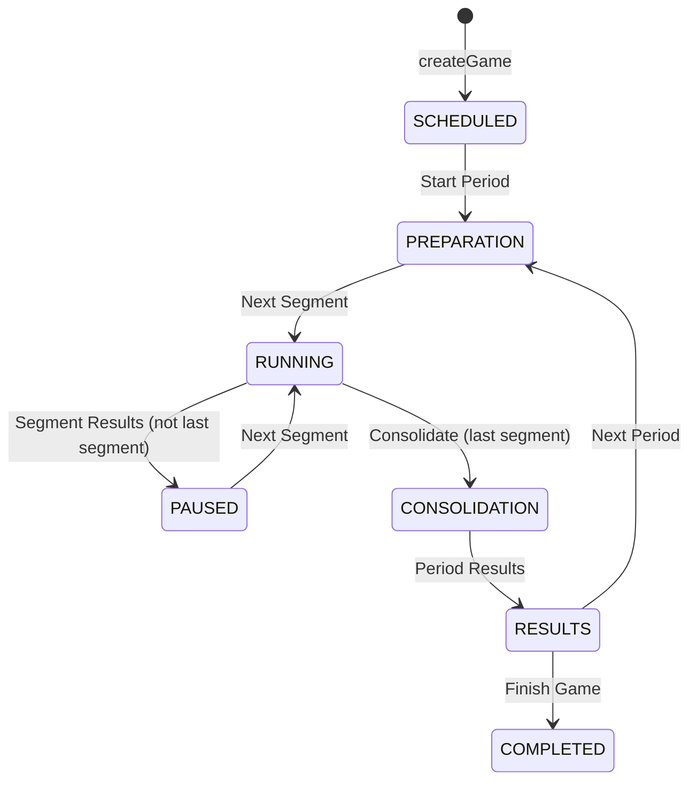

# Game Lifecycle

The whole game runs on **one shared state machine per game** (`Game.status` plus the active period/segment pointers from [game-model.md](game-model.md)). Every transition is triggered by an admin clicking one button; it applies to all players at once. This is what "synchronous" means on this platform — there is no per-player pacing.

Engine: `packages/platform/src/services/GameService.ts` — the instructor advances through periods and segments with `activateNextPeriod` and `activateNextSegment`, and ends play with `finishGame`.

## State machine

At any period’s results, the owning admin or a master can click **Finish Game**. The game can also stay in `RESULTS` until the instructor chooses to continue.

## Transition table

Button labels from the admin cockpit (`apps/demo-game/src/pages/admin/games/[id].tsx:getButton`); computations are what the platform runs during the transition, calling the game's hooks ([developing-a-game.md](developing-a-game.md)).

| From → To               | Admin button      | Mutation              | Platform work and game hooks called                                                                                                                                               |
| ----------------------- | ----------------- | --------------------- | --------------------------------------------------------------------------------------------------------------------------------------------------------------------------------- |
| SCHEDULED → PREPARATION | "Start Period"    | `activateNextPeriod`  | Activates period 0; writes `PERIOD_START` results per player via `PeriodResult.initialize`/`.start`                                                                               |
| PREPARATION → RUNNING   | "Next Segment"    | `activateNextSegment` | Activates next segment; writes `SEGMENT_START` + working `SEGMENT_END` rows via `SegmentResult.initialize`/`.start`; resets all `isReady`                                         |
| RUNNING → PAUSED        | "Segment Results" | `activateNextSegment` | Closes the segment: `Segment.updateDBBeforeActivation` hook (if any), then `SegmentResult.end` per player finalizes `SEGMENT_END` facts; resets `isReady`                         |
| PAUSED → RUNNING        | "Next Segment"    | `activateNextSegment` | Same as PREPARATION → RUNNING, for the next segment                                                                                                                               |
| RUNNING → CONSOLIDATION | "Consolidate"     | `activateNextPeriod`  | Only on the **last** segment: closes it (`SegmentResult.end`), then `Period.consolidate` updates period facts; resets `isReady`                                                   |
| CONSOLIDATION → RESULTS | "Period Results"  | `activateNextPeriod`  | `PeriodResult.end` per player (gets segment-end results, other players' results, consolidation decisions) writes `PERIOD_END` rows; optional `PeriodResult.updateDBAfterEnd` hook |
| RESULTS → PREPARATION   | "Next Period"     | `activateNextPeriod`  | Advances `activePeriodIx`; writes `PERIOD_START` rows for the new period via `PeriodResult.start`                                                                                 |
| RESULTS → COMPLETED     | "Finish Game"     | `finishGame`          | Disconnects the upcoming period and preserves the settled results. Concurrent Finish Game and Next Period requests can commit only one transition.                                |

Notes:

- The "Consolidate" button appears when the game is RUNNING **and** the active segment is the last one (`activeSegmentIx >= segments.length - 1` with `segmentCount` reached) — and it calls `activateNextPeriod`, not `activateNextSegment`.
- Periods and segments are **authored during play or before**: "Add period" (with per-period facts, e.g. a market scenario) and "Add segment" (with attached learning/story elements). Segment facts (e.g. random returns) are computed at _creation_ time by `Segment.initialize`, not at activation time.
- **Period Results** works with a single authored period. `GameService.ts:activateNextPeriod` saves the period-end results and returns the game in `RESULTS`. If the instructor adds another period later, **Next Period** starts it.
- Segment/period transitions reset `Player.isReady` to false for the whole game. (Exception: the initial SCHEDULED → PREPARATION has no explicit reset — players start at `false` anyway.)

## What players see per status

The player cockpit is a single page that switches on `game.status` (`apps/demo-game/src/pages/play/cockpit.tsx`):

| Status        | Player view                                                                                           |
| ------------- | ----------------------------------------------------------------------------------------------------- |
| SCHEDULED     | Joined confirmation and waiting message                                                               |
| PREPARATION   | Header only — waiting while the admin sets up                                                         |
| RUNNING       | Demo game: allocation editor → submitted summary → reversible Ready lock                              |
| PAUSED        | Demo game: reveal progress, then closed-quarter balances and returns after all three monthly reveals  |
| CONSOLIDATION | Demo game: reveal progress, then holdings and benchmarks after all three monthly reveals              |
| RESULTS       | Demo game: completed-year asset totals, accumulated portfolio return, and annual asset market returns |
| COMPLETED     | Game completed above the last settled year’s results. History remains available.                      |

Independent of status: story elements attached to a newly activated segment appear as blocking popups until acknowledged; demo-game learning elements sit in the Team tab (other games may use a sidebar); achievements/level-ups arrive as notifications.

## Registration concurrency

`RegistrationService.ts:withRegistrationLock` runs enrollment, registration controls, and initial start through `registrationTransaction` at read-committed isolation, taking `GameTransaction.ts:lockGameForUpdate` before invoking the transaction callback. Simultaneous joins queue on the game row; initial start reads players and creates results/actions inside that same transaction. A concurrent join either receives initial results or is rejected as closed. Capacity and per-browser uniqueness are enforced server-side. Registration changes publish `REGISTRATION_CHANGED` after commit; the admin's existing event subscription refetches its roster, with polling as fallback.

The registration transaction allows 30 seconds to acquire a transaction/pooled connection (`maxWait`). Its separate 15-second execution limit (`timeout`) includes waiting for the game row lock and performing the work. These limits do not guarantee that an arbitrarily large burst succeeds. `registrationTransaction` retries `P2034` conflicts up to five total attempts.

## Player actions and segment-ending locks

After initial start, the game locks serve gameplay coordination, not enrollment. `PlayService.ts:performAction` takes `GameTransaction.ts:lockGameForShare` on the game row and an exclusive lock on the player's result. Different players can act concurrently. The `RUNNING → PAUSED` branch of `activateNextSegment` and the `RUNNING → CONSOLIDATION` branch of `activateNextPeriod` take `lockGameForUpdate`, waiting for actions to finish before calculating final results. An action that acquires its lock after the transition rereads the state and is rejected as no longer allowed. Later transitions retain the dice-reveal gates below.

Both helpers hold their locks until transaction commit or rollback and return the game ID or `null` if it is absent. They must run before the state reads they protect. A lock on the game row does not automatically protect custom mutations of orders or player results: those mutations must follow the same game-lock protocol and separately protect the rows they read and change.

The former `RegistrationService.ts:lockGame` export has been removed. Import `lockGameForUpdate(tx, { id })` (or `{ registrationToken }`) and `lockGameForShare(tx, gameId)` from `GameTransaction` instead; no compatibility adapter remains. Enrollment and initial start should use `withRegistrationLock` to enforce lock-before-read ordering.

## Coordination mechanics

- **Demo-game Decisions tab** — Ready appears only during RUNNING and requires submission through the editor. Tablet/desktop use Decisions/History top navigation with Team and Market embedded; the phone bottom tabs remain unchanged. It locks editing until switched off; Change allocation requires resubmission before Ready is available again. Submission is persisted per segment, survives reload, and resets at the next segment. This is a cockpit control rule, not API enforcement.
- **Ready flag** — players toggle "Ready" after acting (`updateReadyState`). The admin UI plays a sound and shows "All players are ready!" but the platform never blocks or auto-advances on it.
- **Countdown** — the admin can set a countdown on the active segment (`addCountdown`); players see a ticking widget; the demo game emits readiness reminder toasts only during RUNNING, while configured timers remain visible during review. When it expires **nothing happens automatically** — the admin still clicks the button. Treat it as social pressure, not enforcement.
- **Market reveals** — demo-game rolling is enabled only for the current closed segment in PAUSED/CONSOLIDATION, using `apps/demo-game/src/lib/market.ts:canRevealMarketRoll` on client and server. Closing computes results, then each monthly reveal adds dice and Market overlays. Player Decisions/History/Team publish the quarter’s results after all three valid monthly reveals. Admin reports remain available. The optional platform `Segment.validateAdvance` hook rejects advancement from PAUSED/CONSOLIDATION until the demo game has revealed all three months; other games retain their existing behavior.
- **Realtime** — every transition publishes a global event (`PERIOD_ACTIVATED`, `SEGMENT_ACTIVATED`, `COUNTDOWN_UPDATED`, ...). Clients use these purely as a signal to refetch their queries — no payload is trusted. See [api-layer.md](api-layer.md).

## End-to-end walkthrough

Verified by `playwright/tests/demo-game-flow.spec.ts`:

1. Admin signs in (`/admin/login`, OIDC) and creates a named game. Shared registration is the UI default, with optional capacity; fixed-count mode creates the requested players up front. Status: `SCHEDULED`.
2. Admin adds one or more periods (per-period facts/scenario) and their segments (optionally attaching story/learning elements).
3. For open games, admin shares `/join/game/<registrationToken>` or its QR code. Participants complete bank setup, then register separate entries. Fixed-count games use individual `/join/<token>` links. Admins can copy those private links for recovery.
4. New participants complete the introduction/setup/review flow and arrive in the waiting cockpit. Returning participants resume their entry through the shared link while their browser identity is available, or through their private return link.
5. Admin: **Start Period** closes registration and initializes the complete roster atomically → `PREPARATION`; then **Next Segment** → `RUNNING`. Starting requires at least one player and a configured first period/segment. Registration can be closed/reopened manually only while `SCHEDULED`; existing players can always resume.
6. Players submit their decision(s) for the segment and toggle Ready. Optionally the admin sets a countdown.
7. Admin advances through the transition table above: **Segment Results** / **Next Segment** per segment, **Consolidate** + **Period Results** on the last one, **Next Period** to loop back to step 5 for the next period.
8. The instructor clicks **Finish Game** to end play in one click. Players can revisit their final results and History after reload. The instructor can open the report dashboard (`/admin/reports/[id]`) for cross-period analytics.
